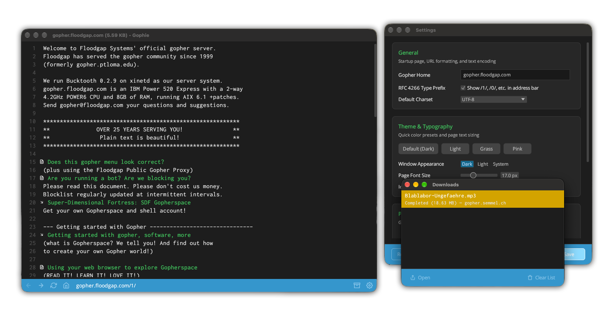

# Gophie

[](https://github.com/jankammerath/Gophie/releases/latest)
[](https://github.com/jankammerath/Gophie/releases/latest)
[](https://github.com/jankammerath/Gophie/releases/latest)
[-A81D33?style=for-the-badge&logo=debian&logoColor=white)](https://github.com/jankammerath/Gophie/releases/latest)
[-EE0000?style=for-the-badge&logo=redhat&logoColor=white)](https://github.com/jankammerath/Gophie/releases/latest)

**Gophie 2 is entirely rewritten in Rust!** Gophie is a fast, native, cross-platform graphical browser for **The Internet Gopher** (RFC 1436 & RFC 4266), rewritten in Rust for high performance and low memory usage on **macOS, Windows, and Linux**.



## Download

Grab the latest pre-built release from the [GitHub Releases](https://github.com/jankammerath/Gophie/releases/latest) page — no external runtime required:

| Platform | Architecture | Package |
| :--- | :--- | :--- |
| **macOS** | Apple Silicon & Intel (Universal) | [Download `.dmg`](https://github.com/jankammerath/Gophie/releases/latest) |
| **Windows** | x64 (self-contained `.exe`) | [Download `x64 .zip`](https://github.com/jankammerath/Gophie/releases/latest) |
| **Windows** | Arm64 (self-contained `.exe`) | [Download `arm64 .zip`](https://github.com/jankammerath/Gophie/releases/latest) |
| **Linux** (Debian / Ubuntu) | amd64 | [Download `.deb`](https://github.com/jankammerath/Gophie/releases/latest) |
| **Linux** (Fedora / RHEL / openSUSE) | x86_64 | [Download `.rpm`](https://github.com/jankammerath/Gophie/releases/latest) |

## Features

- **Full RFC 1436 & RFC 4266 Support**: Renders Gopher menus with line numbers and item-type icons, plain text documents, inline images (PNG, JPEG, GIF, BMP, TIFF, ICO, WebP), Type-7 full-text search (e.g. Veronica-2), external `URL:` links, `mailto:`, and `telnet://` / CCSO sessions.
- **Native Performance**: Hardware-accelerated GPU rendering (`eframe`/`egui`), virtualized row scrolling for massive Gopher menus and text files, zero-copy magic-byte file signature detection, cached image textures, and event-driven idle rendering (~0% idle CPU).
- **Integrated Download Manager**: Parallel streaming downloads with live transfer speed, native Save File dialogs, abort/retry/open controls, and a separate native Downloads window.
- **Full `config.ini` Compatibility**: Reads `~/Gophie/config.ini` with all `[Navigation]`, `[Network]`, and `[Appearance]` color, font size, charset, and homepage settings from the original Gophie.
- **Keyboard Shortcuts**:
  - `Cmd/Ctrl + L`: Focus address bar
  - `Cmd/Ctrl + R` or `F5`: Reload current page
  - `Alt + Left` / `Cmd + [`: Navigate back
  - `Alt + Right` / `Cmd + ]`: Navigate forward
  - `Cmd/Ctrl + A` / `Cmd/Ctrl + C`: Select all & copy page text
  - `Escape`: Stop loading / close search or notification banner

## Building & Running

Requires a recent Rust toolchain (`rustc` / `cargo`).

```bash
# Run in debug mode
cargo run

# Build optimized native binary (macOS, Windows, or Linux)
cargo build --release

# Run unit tests
cargo test
```

The release binary is produced at `target/release/gophie` (or `target/release/gophie.exe` on Windows) with all fonts (`Inconsolata`, `OpenSans`, `Feather`) and icons embedded — no external runtime required.

## Configuration (`~/Gophie/config.ini`)

See [config/config.ini](config/config.ini) for a full sample configuration.

| Section | Setting | Default | Description |
| :--- | :--- | :--- | :--- |
| `Navigation` | `GOPHERHOME` | `gopher.floodgap.com` | Default homepage loaded on startup |
| `Navigation` | `SELECTOR_PREFIX_ENABLED` | `yes` | Show RFC 4266 `/<type>/` prefix in address bar |
| `Network` | `DEFAULT_CHARSET` | `UTF-8` | Character encoding for menus and text files |
| `Appearance` | `PAGE_FONT_SIZE` | `17` | Monospace font size in page view |
| `Appearance` | `PAGE_ICON_FONT_SIZE` | `12` | Feather icon size in menu gutter |
| `Appearance` | `VIEW_BACKGROUND` / `VIEW_TEXTCOLOR` / `PAGE_LINK_COLOR` / … | `#1b1b1b` / `#e8e8e8` / `#22c75c` | Full theme customization via hex colors |

## Architecture

- `src/config/`: `ConfigFile` (INI parser/serializer), `ConfigManager`, `Theme`, and `SystemUtility`.
- `src/io/`: `FileSignature` magic-byte and text-heuristic detector.
- `src/net/`: `GopherUrl`, `GopherItem` / `GopherItemType`, `GopherPage`, `GopherError`, `GopherClient`, and `DownloadManager`.
- `src/ui/`: `MainWindow`, `NavigationBar`, `PageView`, `PageMenu`, `MessageView`, `SearchInput`, `DownloadWindow`, and embedded `assets`.

## License

Licensed under the GNU General Public License v3.0 (GPLv3). See [LICENSE](LICENSE).
